## Introduction

In the resolution-limited regime of deep neural networks, the scaling exponent of the loss is expected to depend on the intrinsic dimension of the data manifold \[[1](#ref-sharma2022scaling), [2](#ref-bahri2024explaining)\]. Motivated by the hypothesis that real-world data are intrinsically low-dimensional \[[3](#ref-cayton2005algorithms)\], we consider fractals embedded in higher-dimensional Euclidean spaces as a synthetic setting for studying this dependence. It has been argued that the fractal or the Hausdorff dimension is the relevant notion of dimension for scaling laws \[[1](#ref-sharma2022scaling)\]. This has been observed empirically in \[[4](#ref-brill2024neural)\] for a percolation cluster with Hausdorff dimension $$d_H=4$$.

We begin by reviewing the theoretical origins of dimension dependence in neural scaling laws on smooth manifolds in the resolution-limited regime. Heuristically, the main idea is that the test loss depends on the expected distance to the nearest training sample, which is controlled by the volume law scaling of the underlying manifold. A straightforward extension of this argument to fractals suggests that the scaling exponent should depend on the Hausdorff dimension of the underlying fractal. To empirically verify this prediction, we consider the random student-teacher experiment on the following datasets:

- The following fractals in increasing order of Hausdorff dimension: Four-corner Cantor dust, Koch curve, Minkowski sausage, Sierpiński carpet, 4D Sierpiński simplex gasket, 3D Menger sponge, 7D Sierpiński simplex gasket, 4D Menger sponge, 5D Menger sponge, 6D Menger sponge, 7D Menger sponge, 10D Cantor dust, 11D Vicsek fractal, 9D Menger sponge, 12D Cantor dust, 13D Vicsek fractal, 11D Menger sponge, 14D Cantor dust, 15D Vicsek fractal, and 13D Menger sponge.

- A four-dimensional Sierpiński simplex gasket embedded in $$d=4,\ldots,10$$, to study how the fitted scaling exponents change with the strength of Gaussian perturbations to the inputs.

## Theoretical Background of Scaling Laws

In this section, we discuss the neural scaling laws in the resolution-limited regime under the assumptions that the target and prediction functions are Lipschitz continuous and piecewise linear. The arguments can be extended to Ahlfors-regular fractals [^1] by replacing the Euclidean dimension with the Hausdorff dimension of the underlying fractal. [^2]

### Dataset scaling

Consider $$D$$ independent training samples 

$$
x_1,\ldots,x_D \overset{\text{i.i.d.}}{\sim} \mu,
    \qquad \operatorname{supp}\mu = \mathcal{M} \subset [0,1]^d , \tag{1}
$$

where $$\mathcal{M}$$ is the data manifold, of intrinsic dimension $$d_{\mathcal{M}}$$, embedded in the unit cube of $$\mathbb{R}^d$$, and $$\mu$$ is the data distribution on it. For a test point $$x$$, let $$x_*$$ be its nearest training sample and let 

$$
R(x) = \min_{1\le i\le D} \lVert x-x_i\rVert
         = \lVert x-x_*\rVert. \tag{2}
$$

We approximate a Lipschitz target $$T$$ by a Lipschitz prediction $$\hat{T}$$. For $$p>0$$, the test loss is considered to be of the following form 

$$
L(D) = \mathbb{E}\!\left[\lvert \hat{T}(x)-T(x)\rvert^p\right]. \tag{3}
$$

In the infinite-parameter limit, we assume that at a training point the prediction exactly matches that of the target, i.e. $$\hat{T}(x_*)=T(x_*)$$. Therefore, we can write the prediction error at a test point as 

$$
\hat{T}(x)-T(x) =
    \hat{T}(x)-\hat{T}(x_*) + T(x_*)-T(x). \tag{4}
$$

Writing $$K_{\hat{T}}$$ and $$K_T$$ for the Lipschitz constants of the prediction and target, we obtain 

$$
\lvert \hat{T}(x)-T(x)\rvert \le (K_{\hat{T}}+K_T)R(x). \tag{5}
$$

Therefore, the scaling behaviour of the loss is controlled by the expected distance to the nearest training sample 

$$
L(D) = O\!\left(\mathbb{E}[R(x)^p]\right). \tag{6}
$$

We now estimate how the distance to the nearest training sample depends on $$D$$. We hold the test point $$x$$ fixed and take probabilities over the training set. For a point $$y\in\mathbb{R}^d$$ and a radius $$r\geq 0$$, define the closed Euclidean ball $$\overline{B}_r(y)=\{z\in\mathbb{R}^d:\lVert z-y\rVert\leq r\}$$. We denote by $$P_x(r)=\Pr(x_i\in\overline{B}_r(x))$$ the probability that a single training sample $$x_i$$ lies within distance $$r$$ of the test point $$x$$. The corresponding complement is $$\overline{P}_x(r)=1-P_x(r)$$.

Considering homogeneous volume scaling, the probability that a single training sample does not lie in the ball of radius $$r$$ about $$x$$ is given by 

$$
\overline{P}_x(r) = 1-c_{d_{\mathcal{M}}} r^{d_{\mathcal{M}}} \, , \tag{7}
$$

provided the ball is contained in the uniform unit cube. Here $$c_{d_{\mathcal{M}}}$$ is the volume of the unit Euclidean ball and depends only on the dimension $$d_{\mathcal{M}}$$. The nearest training sample $$x_*$$ lies outside this ball precisely when all $$D$$ training samples lie outside it. As the training samples are independent, this gives 

$$
\Pr_{\mathrm{train}}(R(x)>r) = [1-P_x(r)]^D \approx \exp(-D c_{d_{\mathcal{M}}} r^{d_{\mathcal{M}}}). \tag{8}
$$

The exponential approximation follows in the limit $$D\to\infty$$.

Thus, the $$p$$th moment of the shortest distance from a test point to the training set is given by 

$$
\mathbb{E}_{\mathrm{train}}[R(x)^p]
      = p\int_0^\infty r^{p-1}
            \Pr_{\mathrm{train}}(R(x)>r)\,\mathrm{d}r  = \mathcal{O}(D^{-p/d_{\mathcal{M}}}). \tag{9}
$$

For Lipschitz target and prediction functions, Eq. [(6)](#eq-loss-distance-bound) then gives the bound 

$$
L(D) = O\!\left(D^{-p/d_{\mathcal{M}}}\right). \tag{10}
$$

For data sampled from a fractal data manifold, the same argument applies with the intrinsic dimension $$d_{\mathcal{M}}$$ replaced by the Hausdorff dimension $$d_H$$ of the underlying fractal, i.e. $$d_{\mathcal{M}} = d_H$$, as 

$$
\overline{P}_x(r) \asymp 1-c_{d_H} r^{d_H} \, , \tag{11}
$$

and consequently, the loss scaling with dataset size is given by 

$$
L(D) = O\!\left(D^{-p/d_H}\right). \tag{12}
$$

For a smooth piecewise linear target and prediction, we can further assume that the interpolation error is bounded by the square of the distance to the nearest training sample, i.e. $$\lvert\hat{T}(x)-T(x)\rvert\leq C R(x)^2$$, with a constant $$C$$ \[[1](#ref-sharma2022scaling)\]. Therefore, loss scaling with dataset size is given by 

$$
L(D) = O\!\left(\mathbb{E}[R(x)^{2p}]\right)
         = O\!\left(D^{-2p/d_H}\right). \tag{13}
$$

For mean squared error, $$p=2$$, this becomes 

$$
L(D) = O\!\left(D^{-4/d_H}\right). \tag{14}
$$

### Parameter scaling

The argument is analogous to dataset resolution scaling. In the infinite-data regime, suppose a model with $$N$$ parameters agrees with the target at $$N$$ points $$x_i$$, so $$\hat{T}(x_i)=T(x_i)$$. These points behave as independent samples from the data distribution. In this case the probability that a test point lies outside the ball of radius $$r$$ about all $$N$$ points is given by 

$$
\Pr(R>r) = [1-P_x(r)]^N \approx \exp(-N c_{d_{\mathcal{M}}} r^{d_{\mathcal{M}}}). \tag{15}
$$

As before, the loss as a function of parameter count is given by 

$$
L(N) = O\!\left(N^{-p/d_{\mathcal{M}}}\right), \tag{16}
$$

and for piecewise linear target and prediction functions, we have 

$$
L(N) = O\!\left(N^{-4/d_{\mathcal{M}}}\right). \tag{17}
$$

For Ahlfors-regular fractals, $$d_{\mathcal{M}} = d_H$$.

## Teacher/student experiments on fractals

Fractals are generated using the chaos game algorithm  \[[5](#ref-weissteinChaosGame), [6](#ref-barnsley1993fractals)\]. In this algorithm, we fix the vertices of a polytope and place a walker at a random initial position. At each step, one of the vertices of the polytope is randomly selected according to a prescribed probability distribution. The walker then moves a fixed fraction of its distance towards the selected vertex. After each step, we record the walker’s position. After multiple iterations of the process, the positions of the random walker converge towards a fractal. Essentially, the fractal forms the attractor of this recursion. As an example, for the Sierpiński gasket, we start with vertices of an equilateral triangle and an arbitrary starting point. A random walker can move halfway towards each vertex with equal probability at each step. Once the fractal is generated we perform the relevant data sampling procedure on the fractal.

We then test the scaling law predictions in a toy setting with targets generated by a fixed teacher network with ReLU activations with the fractal dataset as the input. We train a fully connected student with MSE as the loss function.

**Dataset scaling:** We use a teacher with two hidden layers with shape $$[d,96,96,1]$$ with $$d$$ being the embedding dimension. We hold the student architecture of shape $$[d,192,192,1]$$ fixed and vary the training-set size $$D$$ from $$2^3$$ to $$2^{13}$$. We consider 90 such trials of the experiment for datasets sampled from different fractals.

**Parameter scaling:** Similarly, for parameter scaling we keep the teacher fixed and vary the widths of the two hidden layers of the student. The teacher has shape $$[d,600,600,1]$$ and the student has $$[d,n,n,1]$$. Then we perform the scaling by varying $$n$$ from $$8$$ to $$38$$. We run 90 such trials.

For both experiments, we average the log losses across runs at each size. We fit these averages in log space using a power law with a constant offset, $$L(q)=L_\infty+Aq^{-\alpha_q}$$, where $$q=D$$ or $$N$$ is the training-set size or parameter count. The fits give $$\alpha_D$$ and $$\alpha_N$$, and we report their fit standard errors. We estimate the intrinsic dimension of the sampled inputs using TwoNN \[[7](#ref-facco2017estimating)\].

### Sierpiński gasket and Vicsek fractal

In this set of experiments, we consider the Sierpiński gasket and the Vicsek fractal embedded in $$\mathbb{R}^d$$ with $$d \in [2,10]$$. For $$d>2$$, we generate planar points for each fractal and embed them nonlinearly using a smooth map. Figures [1](#fig-gasket-embedding) and [2](#fig-vicsek-embedding) show the planar fractals and their nonlinear embeddings in three dimensions.

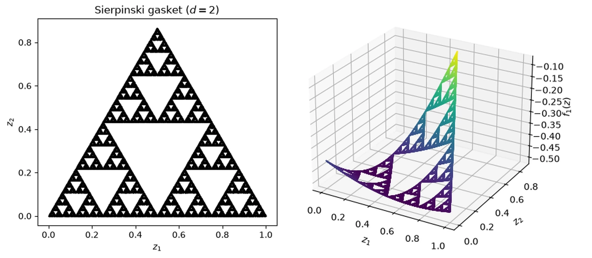

*Figure 1.* The Sierpiński gasket in its original two-dimensional space (left) and after nonlinear embedding in three dimensions (right).

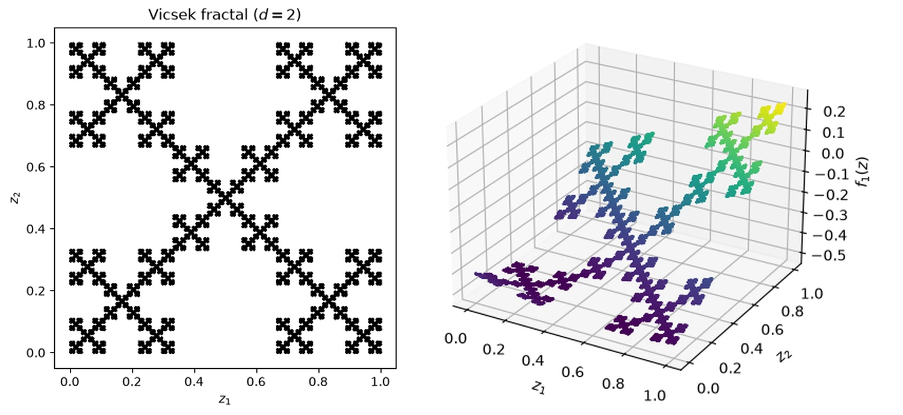

*Figure 2.* The Vicsek fractal in its original two-dimensional space (left) and after nonlinear embedding in three dimensions (right).

In Tables [1](#tab-gasket-twonn) and [2](#tab-vicsek-twonn), we report TwoNN estimates of the intrinsic dimension of the dataset for each dimension. The Hausdorff dimensions are $$d_H=\log 3/\log 2\approx 1.585$$ for the Sierpiński gasket and $$d_H=\log 5/\log 3\approx 1.465$$ for the Vicsek fractal. We see that the measured dimension agrees well with the Hausdorff dimension.

*Table 1.* TwoNN dimension and inverse scaling exponents of the Sierpiński gasket. Uncertainties are fit standard errors propagated to $$4/\alpha$$.

| Embedding dimension $$d$$ | TwoNN dimension | $$4/\alpha_D$$ | $$4/\alpha_N$$ |
| --- | --- | --- | --- |
| 2 | 1.565 | $$2.08 \pm 0.02$$ | $$1.83 \pm 0.08$$ |
| 3 | 1.564 | $$2.26 \pm 0.02$$ | $$1.61 \pm 0.02$$ |
| 4 | 1.568 | $$2.21 \pm 0.01$$ | $$1.85 \pm 0.11$$ |
| 5 | 1.545 | $$2.20 \pm 0.02$$ | $$1.83 \pm 0.16$$ |
| 6 | 1.569 | $$2.15 \pm 0.04$$ | $$1.66 \pm 0.08$$ |
| 7 | 1.632 | $$2.20 \pm 0.01$$ | $$1.86 \pm 0.04$$ |
| 8 | 1.563 | $$2.21 \pm 0.01$$ | $$2.08 \pm 0.04$$ |
| 9 | 1.570 | $$2.21 \pm 0.02$$ | $$1.97 \pm 0.05$$ |
| 10 | 1.570 | $$2.23 \pm 0.02$$ | $$1.99 \pm 0.08$$ |

*Table 2.* TwoNN dimension and inverse scaling exponents of the Vicsek fractal. Uncertainties are fit standard errors propagated to $$4/\alpha$$.

| Embedding dimension $$d$$ | TwoNN dimension | $$4/\alpha_D$$ | $$4/\alpha_N$$ |
| --- | --- | --- | --- |
| 2 | 1.442 | $$1.98 \pm 0.02$$ | $$1.73 \pm 0.20$$ |
| 3 | 1.455 | $$2.15 \pm 0.02$$ | $$1.54 \pm 0.03$$ |
| 4 | 1.420 | $$2.13 \pm 0.02$$ | $$1.72 \pm 0.10$$ |
| 5 | 1.489 | $$2.14 \pm 0.02$$ | $$1.71 \pm 0.05$$ |
| 6 | 1.436 | $$2.15 \pm 0.02$$ | $$1.68 \pm 0.04$$ |
| 7 | 1.476 | $$2.12 \pm 0.01$$ | $$1.70 \pm 0.10$$ |
| 8 | 1.449 | $$2.10 \pm 0.01$$ | $$2.05 \pm 0.11$$ |
| 9 | 1.442 | $$2.16 \pm 0.01$$ | $$2.01 \pm 0.04$$ |
| 10 | 1.447 | $$2.18 \pm 0.01$$ | $$2.01 \pm 0.13$$ |

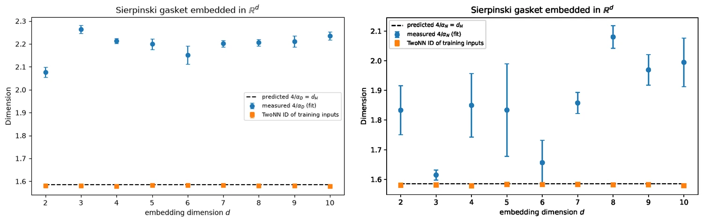

*Figure 3.* Gasket estimates of $$4/\alpha_D$$ (left) and $$4/\alpha_N$$ (right) with one propagated fit standard error. The dashed line gives $$d_H$$. Orange points show mean TwoNN across dataset-scaling seeds, rounded to two decimal places in the right panel.

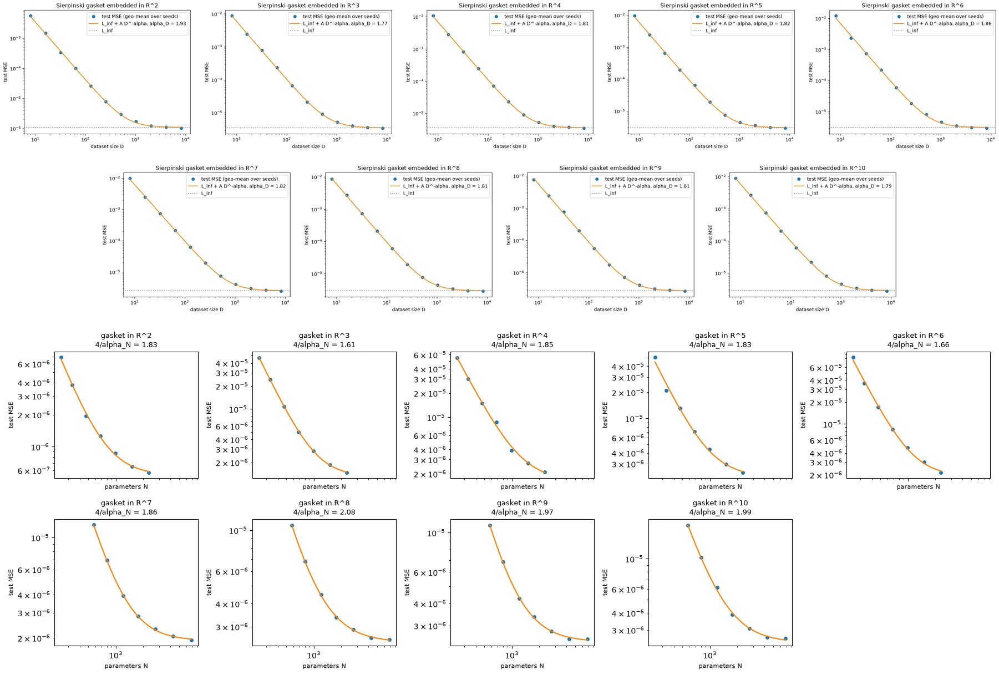

*Figure 4.* Sierpiński gasket loss curves for $$d=2,\ldots,10$$. The upper grid varies training-set size $$D$$ and the lower grid varies parameter count $$N$$.

We observe that the scaling remains fairly independent of the embedding dimension (cf. Figure [5](#fig-vicsek-exponents) and Figure [5](#fig-vicsek-exponents)). However, the observed $$4/\alpha_q$$ is greater than the intrinsic dimension of the underlying data manifold. This is consistent with observations in \[[1](#ref-sharma2022scaling)\] for small intrinsic dimensions.

We make similar observations for the Vicsek fractal. The $$4/\alpha_q$$ is fairly independent of the embedding dimension but systematically overestimates the dimension when compared with the TwoNN estimate.

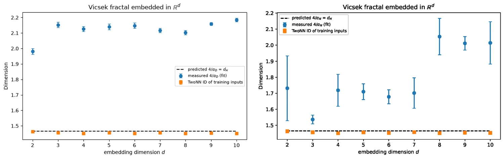

*Figure 5.* Fitted $$4/\alpha_D$$ (left) and $$4/\alpha_N$$ (right) for the Vicsek fractal. The dimension estimates and fit error bars are shown as in Figure [3](#fig-gasket-exponents).

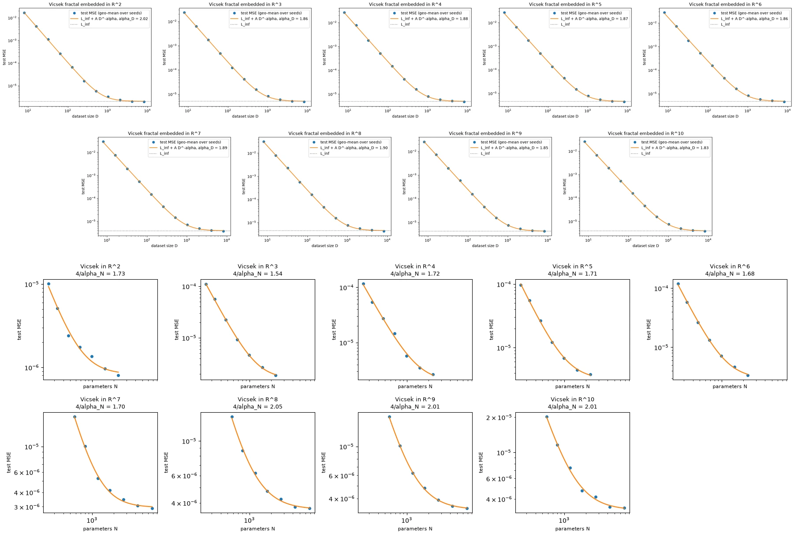

*Figure 6.* Vicsek fractal loss curves for $$d=2,\ldots,10$$. The upper grid varies training-set size $$D$$ and the lower grid varies parameter count $$N$$.

### Fractals of increasing Hausdorff dimension

We now compare twenty fractals with increasing Hausdorff dimensions from $$1.000$$ to $$10.036$$. Figure [7](#fig-native-fractals) shows the generated fractals in embedding dimensions $$d=2$$ and $$d=3$$.

Table [3](#tab-native-fractal-results) lists the fractals in increasing order of $$d_H$$. The TwoNN estimates are close to the theoretical dimensions across the set. However, as in Section [3](#teacherstudent-experiments-on-fractals), the loss scaling does not seem to accurately predict the dimension for lower-dimensional fractals. The agreement gets better with increasing $$d_H$$.

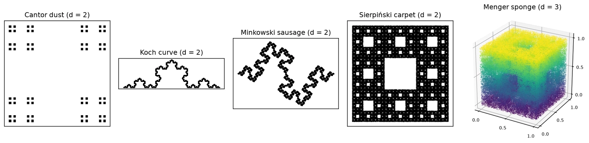

*Figure 7.* The fractals with $$d\le3$$: the four planar fractals and the three-dimensional Menger sponge (right), coloured by $$x_3$$. Fractals with $$d>3$$ are not shown.

*Table 3.* Dimension $$d$$, theoretical Hausdorff dimension $$d_H$$, TwoNN dimension, and inverse scaling exponents for the twenty fractals. TwoNN is measured on one sample of $$2^{13}$$ points per fractal. Uncertainties are fit standard errors propagated to $$4/\alpha$$.

| Fractal | $$d$$ | $$d_H$$ | TwoNN | $$4/\alpha_D$$ | $$4/\alpha_N$$ |
| --- | --- | --- | --- | --- | --- |
| Four-corner Cantor dust | 2 | 1.000 | 0.973 | $$1.71 \pm 0.02$$ | $$1.12 \pm 0.12$$ |
| Koch curve | 2 | 1.262 | 1.239 | $$1.99 \pm 0.02$$ | $$1.44 \pm 0.21$$ |
| Minkowski sausage | 2 | 1.500 | 1.463 | $$1.96 \pm 0.03$$ | $$1.36 \pm 0.12$$ |
| Sierpiński carpet | 2 | 1.893 | 1.900 | $$2.13 \pm 0.02$$ | $$1.77 \pm 0.19$$ |
| 4D Sierpiński simplex gasket | 4 | 2.322 | 2.269 | $$2.84 \pm 0.01$$ | $$1.93 \pm 0.08$$ |
| 3D Menger sponge | 3 | 2.727 | 2.660 | $$2.91 \pm 0.02$$ | $$1.76 \pm 0.06$$ |
| 7D Sierpiński simplex gasket | 7 | 3.000 | 2.941 | $$3.31 \pm 0.09$$ | $$2.79 \pm 0.09$$ |
| 4D Menger sponge | 4 | 3.524 | 3.301 | $$3.53 \pm 0.04$$ | $$2.57 \pm 0.12$$ |
| 5D Menger sponge | 5 | 4.295 | 4.141 | $$4.14 \pm 0.06$$ | $$3.24 \pm 0.13$$ |
| 6D Menger sponge | 6 | 5.047 | 4.643 | $$4.62 \pm 0.11$$ | $$3.68 \pm 0.14$$ |
| 7D Menger sponge | 7 | 5.786 | 5.359 | $$4.98 \pm 0.14$$ | $$4.55 \pm 0.18$$ |
| 10D Cantor dust | 10 | 6.309 | 6.885 | $$6.01 \pm 0.16$$ | $$5.84 \pm 0.21$$ |
| 11D Vicsek fractal | 11 | 6.941 | 7.192 | $$5.96 \pm 0.19$$ | $$5.79 \pm 0.20$$ |
| 9D Menger sponge | 9 | 7.230 | 6.780 | $$5.76 \pm 0.20$$ | $$5.60 \pm 0.17$$ |
| 12D Cantor dust | 12 | 7.571 | 7.461 | $$6.58 \pm 0.18$$ | $$6.74 \pm 0.09$$ |
| 13D Vicsek fractal | 13 | 8.202 | 7.534 | $$6.46 \pm 0.21$$ | $$6.86 \pm 0.17$$ |
| 11D Menger sponge | 11 | 8.644 | 7.926 | $$6.07 \pm 0.20$$ | $$5.95 \pm 0.23$$ |
| 14D Cantor dust | 14 | 8.833 | 8.017 | $$6.43 \pm 0.23$$ | $$6.62 \pm 0.34$$ |
| 15D Vicsek fractal | 15 | 9.464 | 8.670 | $$6.46 \pm 0.23$$ | $$6.67 \pm 0.21$$ |
| 13D Menger sponge | 13 | 10.036 | 8.662 | $$6.39 \pm 0.22$$ | $$6.78 \pm 0.18$$ |

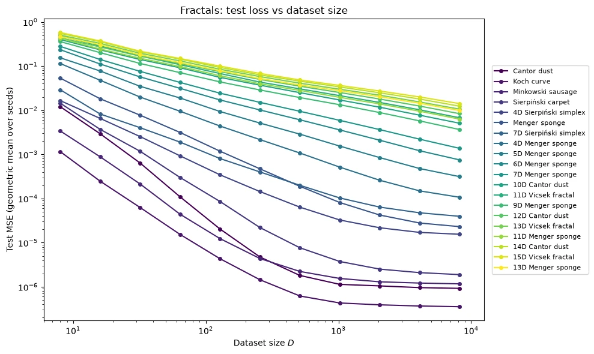

*Figure 8.* Dataset scaling for the twenty fractals: mean squared error versus training-set size $$D$$, using the geometric mean across seeds.

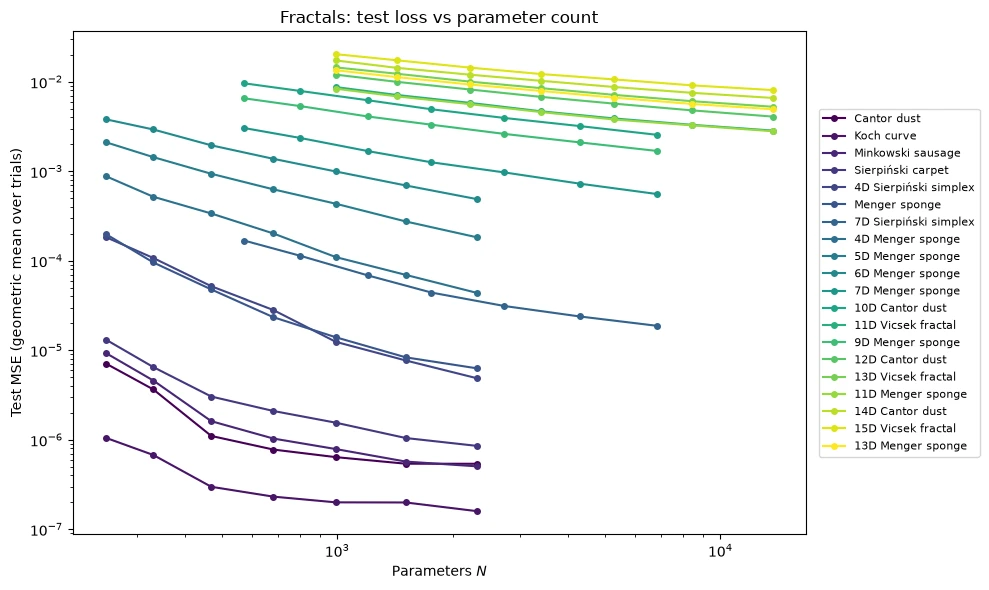

*Figure 9.* Parameter scaling for the twenty fractals: mean squared error versus student parameter count $$N$$, using the geometric mean across trials.

### Gaussian smearing of the simplex gasket

We construct a dataset that shares the structure of both the fractal and the embedding space $$\mathbb{R}^d$$. We centre a $$d$$-dimensional Gaussian of width $$\sigma$$ at each sampled fractal point and assign it a random peak drawn uniformly between 0 and 1. For small $$\sigma$$, we expect the intrinsic dimension of the dataset to be closer to that of the underlying fractals. For a larger spread the intrinsic dimension should be closer to the embedding dimension. We expect that despite the increase in intrinsic dimension the scaling laws should be more consistent with the underlying fractal as that consists of the independently sampled part of the data.

As a concrete example, we consider the four-dimensional Sierpiński simplex gasket, with Hausdorff dimension $$d_H=\log 5/\log 2\approx2.322$$. We then embed the centred points in embedding dimensions $$d=4,\ldots,10$$ with two spreads $$\sigma_0 = 2 \times 10^{-3}$$ and $$\sigma_1 = 2 \times 10^{-2}$$. In Table [4](#tab-gaussian-mixture-fits), we observe that the TwoNN increases with the embedding dimension and matches the numerical value for the larger spread. However, the scaling law prediction remains fairly stable with increasing $$\sigma$$, indicating that the underlying fractal structure plays a dominant role in dictating the scaling dimension.

*Table 4.* Input TwoNN and fitted inverse scaling exponents at both smearing scales. Uncertainties are fit standard errors propagated to $$4/\alpha$$.

| Embedding dimension $$d$$ | $$\sigma_0\approx2\times10^{-3}$$ TwoNN | $$\sigma_0\approx2\times10^{-3}$$ $$4/\alpha_D$$ | $$\sigma_0\approx2\times10^{-3}$$ $$4/\alpha_N$$ | $$\sigma_1=2\times10^{-2}$$ TwoNN | $$\sigma_1=2\times10^{-2}$$ $$4/\alpha_D$$ | $$\sigma_1=2\times10^{-2}$$ $$4/\alpha_N$$ |
| --- | --- | --- | --- | --- | --- | --- |
| 4 | 2.33 | $$3.05 \pm 0.02$$ | $$2.49 \pm 0.09$$ | 3.97 | $$3.30 \pm 0.03$$ | $$2.61 \pm 0.12$$ |
| 5 | 2.46 | $$3.03 \pm 0.03$$ | $$2.41 \pm 0.11$$ | 4.81 | $$3.36 \pm 0.06$$ | $$2.66 \pm 0.15$$ |
| 6 | 2.58 | $$3.05 \pm 0.03$$ | $$2.45 \pm 0.15$$ | 5.57 | $$3.51 \pm 0.06$$ | $$2.60 \pm 0.15$$ |
| 7 | 2.70 | $$3.04 \pm 0.02$$ | $$2.85 \pm 0.15$$ | 6.32 | $$3.58 \pm 0.06$$ | $$3.62 \pm 0.19$$ |
| 8 | 2.81 | $$3.07 \pm 0.04$$ | $$2.62 \pm 0.06$$ | 6.97 | $$3.66 \pm 0.07$$ | $$3.49 \pm 0.11$$ |
| 9 | 2.92 | $$3.07 \pm 0.02$$ | $$2.80 \pm 0.10$$ | 7.52 | $$3.76 \pm 0.06$$ | $$3.79 \pm 0.15$$ |
| 10 | 3.03 | $$3.16 \pm 0.02$$ | $$2.72 \pm 0.15$$ | 8.05 | $$3.90 \pm 0.06$$ | $$3.76 \pm 0.21$$ |

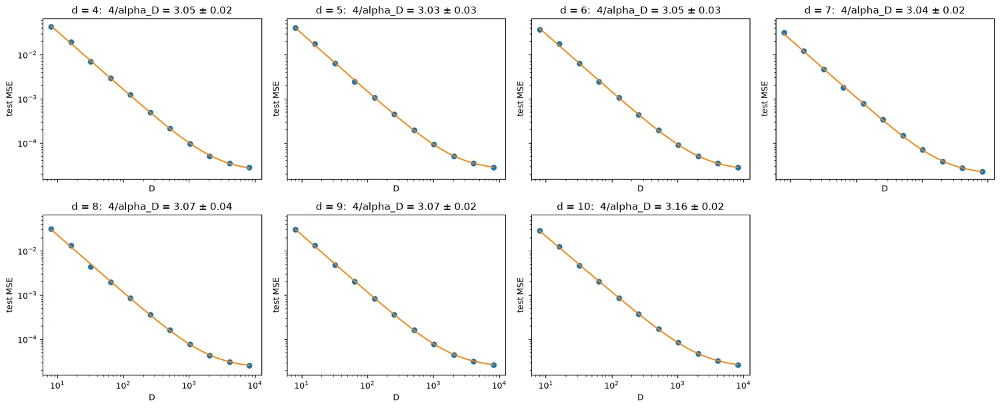

*Figure 10.* Dataset scaling for the Gaussian mixture at the smaller smearing scale $$\sigma_0$$: loss versus training-set size $$D$$ with fits.

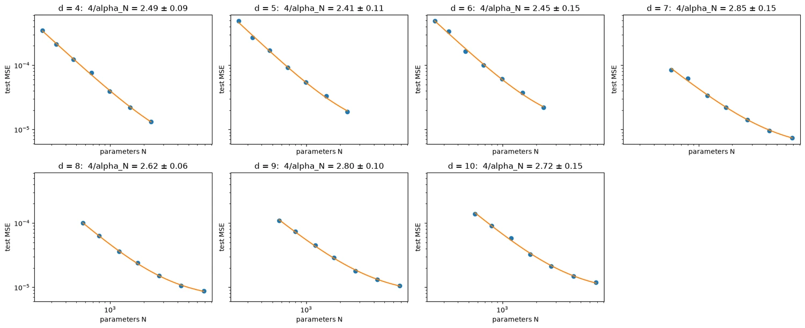

*Figure 11.* Parameter scaling for the Gaussian mixture at the smaller smearing scale $$\sigma_0$$: loss versus parameter count $$N$$ with fits.

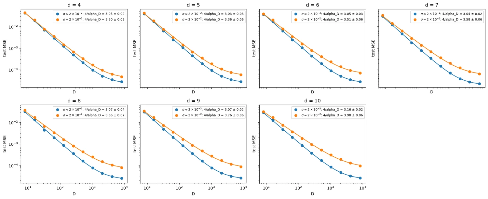

*Figure 12.* Dataset scaling at the two smearing scales, $$\sigma_0\approx2\times10^{-3}$$ and $$\sigma_1=2\times10^{-2}$$: data and fits at both scales.

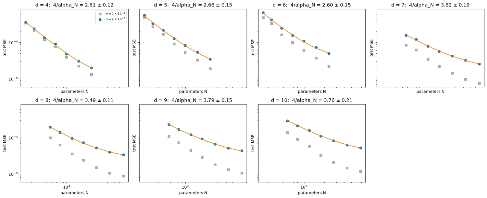

*Figure 13.* Parameter scaling at the two smearing scales, $$\sigma_0\approx2\times10^{-3}$$ and $$\sigma_1=2\times10^{-2}$$: data at both scales and the fit at $$\sigma_1$$.

## Results and Discussion

We find that for fractal-based synthetic datasets, the dataset and parameter scaling laws in the resolution-limited regime should be dictated by their Hausdorff dimension. We empirically test this across a variety of fractals. First, we consider the Sierpiński gasket and the Vicsek fractal embedded in a $$d$$-dimensional hypercube, with $$d \in [2,10]$$. We find that scaling laws are fairly independent of the embedding dimension as shown in Figures [3](#fig-gasket-exponents) and [5](#fig-vicsek-exponents) and Tables [1](#tab-gasket-twonn) and [2](#tab-vicsek-twonn).

Following that, we consider several regular fractals embedded in their natural dimension and we find that the scaling laws agree more closely with the fractal dimension as shown in Figures [8](#fig-native-fractal-dataset-loss) and [9](#fig-native-fractal-parameter-loss) and Table [3](#tab-native-fractal-results).

Next, we investigate synthetic datasets that share characteristics of both the embedding space and the underlying fractal dataset. The dataset consists of $$d$$-dimensional Gaussians centred on a four-dimensional Sierpiński simplex gasket with random weights distributed uniformly between zero and one. Here $$d \in [4,10]$$. We consider two spreads, $$\sigma = 2 \times 10^{-3}$$ and $$\sigma = 2 \times 10^{-2}$$. As expected, the TwoNN intrinsic dimension of the dataset is more than the Hausdorff dimension (Table [4](#tab-gaussian-mixture-fits)). In fact, for $$\sigma = 0.2$$, it is closer to the embedding dimension. However, the scaling laws seem to closely agree with the underlying dimension of the fractal (Figures [12](#fig-gaussian-mixture-width) and [13](#fig-gaussian-mixture-width-parameter)). This suggests that the underlying independent data plays a role in the case of correlated data.

## References

\[1\] Utkarsh Sharma and Jared Kaplan. Scaling laws from the data manifold dimension. Journal of Machine Learning Research. 2022. <https://jmlr.org/papers/v23/20-1111.html>.

\[2\] Yasaman Bahri, Ethan Dyer, Jared Kaplan, Jaehoon Lee, and Utkarsh Sharma. Explaining neural scaling laws. Proceedings of the National Academy of Sciences. 2024. <https://doi.org/10.1073/pnas.2311878121>.

\[3\] Lawrence Cayton. Algorithms for manifold learning. 2005. <https://cseweb.ucsd.edu/~lcayton/resexam.pdf>.

\[4\] Ari Brill. Neural scaling laws rooted in the data distribution. 2024. <https://arxiv.org/abs/2412.07942>.

\[5\] Eric W. Weisstein. [Chaos game](https://mathworld.wolfram.com/ChaosGame.html).

\[6\] Michael F. Barnsley. Fractals everywhere. 1993.

\[7\] Elena Facco, Maria d’Errico, Alex Rodriguez, and Alessandro Laio. [Estimating the intrinsic dimension of datasets by a minimal neighborhood information](https://doi.org/10.1038/s41598-017-11873-y). Scientific Reports. 2017.

[^1]: Ahlfors-regular fractals are fractals in which the volume of a ball of radius $$r$$ centered at some $$x$$ scales as $$r^{d_H}$$ for sufficiently small length scales independently of $$x$$.

[^2]: We note that the arguments about piecewise linear approximation strictly work on smooth manifolds, but we expect the same scaling behaviour to hold for extensions to the embedding space of Ahlfors-regular fractals.
